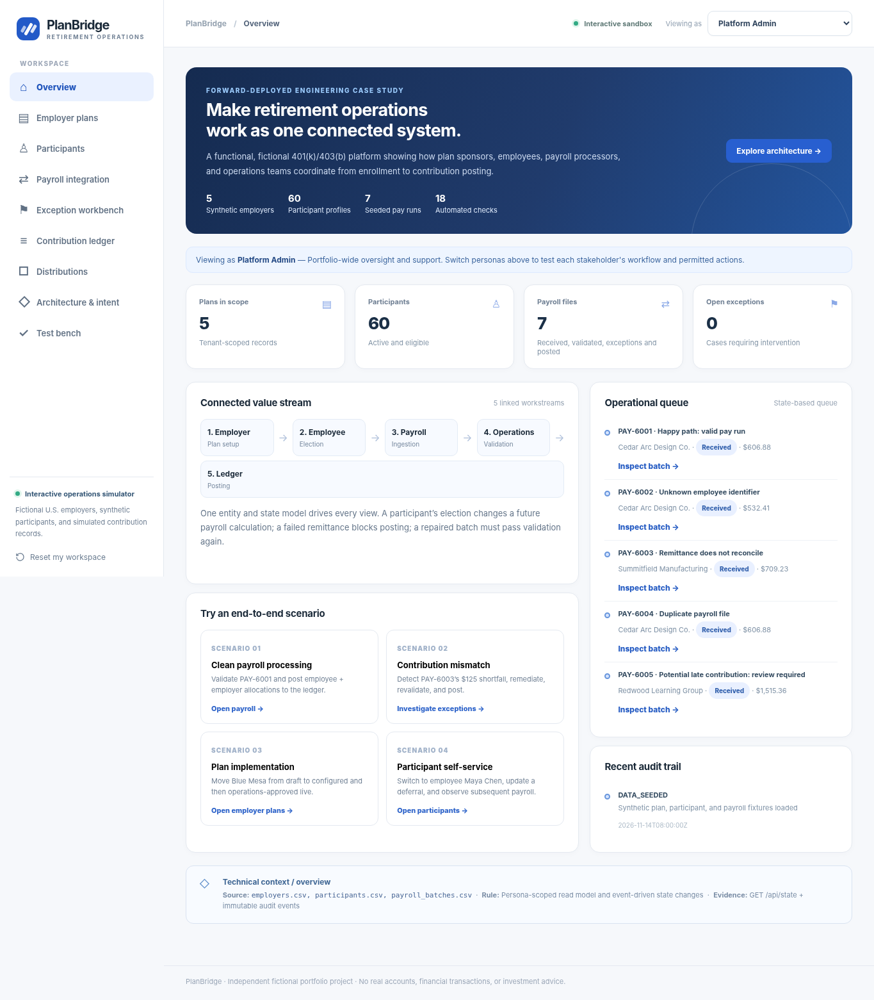

# PlanBridge — Retirement Operations Studio

**Live application:** https://planbridge-retirement-ops.onrender.com/  
**Portfolio:** https://sachintechpro.github.io/#projects  
**Source:** https://github.com/sachintechpro/planbridge-retirement-ops

**A working forward-deployed engineering case study**: fictional U.S. 401(k)/403(b) retirement operations, modeled on industry workflows rather than on any particular provider's proprietary product. Independent portfolio project; **not affiliated with Human Interest** or any other provider.

> **Purpose:** Demonstrate how an FDE can discover operational friction, build a role-aware application, integrate payroll-style feeds, encode business workflow gates, diagnose exceptions, create auditable state changes, and verify the solution with runnable tests. The software uses synthetic data. It never moves money, opens real financial accounts, or provides investment, fiduciary, or legal advice.




**Mobile UI release:** v2.1 · normalized typography, iPhone-safe layouts, and contextual help.

## Readable mobile interface and contextual guidance

The current interface uses a **consistent responsive typography scale** across all nine pages, including a compact 15px technical-note style. On small screens the navigation becomes a drawer, long tables scroll *inside* their cards, and field tooltips open inside the viewport. The design is checked at **320, 375, 393, 768, and 1440 CSS pixels**. The theme uses warm cream, plum, and terracotta rather than a standard blue/white template.

Each page includes business, technical, and Guidewire-pattern comparison help. The Guidewire material is **architectural comparison**, not an InsuranceSuite integration. The app remains a fictional retirement operations system.

## Start here: 7-minute guided demo

This project is meant to be **tested**, not just read. A hiring manager can explore each persona, process a realistic payroll batch, diagnose errors, examine the simulated money trail, and run the automated QA evidence without requesting credentials.

| Time | Persona / page | Action to try | Evidence to inspect |
|---|---|---|---|
| 0:00–1:00 | **Overview** · Platform Admin | Review multi-employer KPIs, recent activity and the operational queues | Realistic seeded workloads, exception counts, role-scoped navigation |
| 1:00–2:30 | **Payroll** · Payroll Specialist | Select `PAY-6001` and **Validate payroll** | Reconciliation result and state transition `received → validated` |
| 2:30–3:30 | **Payroll** · Operations Analyst | Open `PAY-6001` and **Post fictional contributions** | Ledger entries, participant totals, audit trail, idempotency guard against second posting |
| 3:30–4:30 | **Exceptions** · Operations Analyst | Validate `PAY-6003`, diagnose and reconcile the short remittance, then revalidate | Failure details, required repair, no bypass of validation |
| 4:30–5:30 | **Employers** · Employer Administrator | Try activating the configured plan, then switch to Operations | Server-side authority gate and approved `draft → configured → live` sequence |
| 5:30–6:15 | **Participants** · Employee Maya Chen | Change deferral and create a distribution inquiry | Own-account scoping, effective-forward election, human review without disbursement |
| 6:15–7:00 | **Test bench / Architecture** · Platform Admin | Run the 18 checks, inspect evidence and explore technical context | Executable simulator QA, architecture, API behavior and production-hardening requirements |

**Suggested interview narration:** “I mapped a retirement platform’s cross-functional processes into states, actor permissions and traceable decisions. I seeded normal and failure paths, implemented a backend that rejects prohibited actions, and created a test bench so you can verify the behavior yourself. This is intentionally a synthetic simulation—no real participants, payroll providers or financial accounts.”

For an expanded click-by-click walkthrough, see [Demo Guide](docs/DEMO_GUIDE.md).

## Instant preview (no server)

Open `preview.html` in a browser to interact with the self-contained client-side simulation (or download the single-file preview separately). This is a convenience preview, not the Python API: its Test bench displays the recorded baseline 18-check report. Use the full server below for live Python engine tests and server-side permission checks.

## Try the app locally — no API keys

Requires **Python 3.10+**. Nothing to install from pip.

```bash
python server.py
```

Open **http://localhost:8000**. Choose a persona in the top-right corner. On Windows, use `py server.py` if `python` is not recognized.

Run tests:

```bash
python -m unittest discover -s tests -v
```

The **Test bench** tab also runs 18 isolated business/technical checks and exposes the evidence for each. The repository includes 24 standalone Python unit/workflow and responsive UI contract tests.

## Business workflow

```text
Employer onboarding: draft → configured → live (Operations approval)
                  |
Employee election: enroll → choose deferral (effective next unprocessed payroll)
                  |
Payroll ingestion: received → validate → validated → post → ledger
                                  |                       |
                               exception                 audit event
                                  |
                   investigate → controlled repair → revalidate

Distribution inquiry: employee request → human review → reviewed (NO disbursement)
```

### Personas (switch freely in the demo)

| Persona | Employer access | Permitted operations |
|---|---|---|
| Platform Admin | All fictional employers | All operations + reset |
| Operations Analyst | All fictional employers | Validate, repair, post, activate plan, review requests |
| Employer Administrator · Cedar Arc | Cedar Arc only | View employer/employee data; advance draft to configured |
| Payroll Specialist · Cedar Arc | Cedar Arc only | Validate Cedar Arc payroll batches; cannot post or modify other tenants |
| Employee · Maya Chen | Own participant account | Change own deferral; submit a request for human review |

**Security scope:** `Engine.allowed()` enforces simulated role and tenant permissions server-side. The role switcher is intentionally open to visitors; it is *not* real authentication. A production version would need OAuth/OIDC, audit-secure identities, encryption, persistent tenant isolation, access reviews, and other controls.

## Guided demonstrations

1. **Happy-path payroll**: Choose **Payroll Specialist**, open **PAY-6001**, click **Validate payroll**. Switch to **Operations Analyst**, open the same batch, click **Post fictional contributions**. Review **Contribution ledger**, participant balance, and recent audit events. Posting twice is rejected.
2. **Short remittance**: As **Operations Analyst**, validate **PAY-6003**. Observe `REMITTANCE_MISMATCH` and the variance. Under **Exception workbench**, choose the batch, click **Reconcile remittance**, then **Validate payroll** and **Post**. The correction is audited; validation is mandatory.
3. **Unknown participant**: As Operations, validate **PAY-6002**. Review `UNKNOWN_PARTICIPANT` and `REMITTANCE_MISMATCH`; remove unmatched line in the workbench, revalidate, and post. In a real operation, a human would also confirm the proper handling of excluded deductions.
4. **Duplicate ingestion**: Validate or post **PAY-6001**, then validate **PAY-6004**. The reused external run ID is blocked.
5. **Contribution timing flag**: Validate **PAY-6005**. Observe `TIMELINESS_REVIEW`. Operations can record a *review acknowledgment*, then revalidate. This **does not assert compliance or resolve any regulatory violation**.
6. **Sponsor onboarding**: Select **Platform Admin** or **Operations**, open **Blue Mesa Kitchens (EMP-104)**, advance `draft → configured → live`. As the **Employer Administrator**, a configured plan cannot be activated.
7. **Employee self-service**: Switch to **Employee · Maya Chen**, open **Participants**, change the employee deferral. Observe role-scoped navigation and the event; no previously posted contributions are recalculated.
8. **Distribution inquiry**: As Maya, submit a $250 request. Operations reviews it. **No eligibility adjudication, withdrawal, taxes, or money movement occurs.**
9. **Test bench**: Run all 18 checks, inspect PASS/FAIL evidence; reset the session and rerun. The test runner uses fresh engine instances and does not mutate the visitor’s scenario.

## Synthetic data fixtures

| File | Purpose | Count |
|---|---|---:|
| `data/employers.csv` | U.S. employers, plan configuration, payroll providers, lifecycle states | 5 |
| `data/participants.csv` | Completely fictional names, employee IDs, account balances, elections | 60 |
| `data/payroll_batches.csv` | Batch IDs, external run IDs, remittances, dates, injected failure reasons | 7 |
| `data/payroll_lines.csv` | Gross eligible wages by employer and employee | 28 |

All names and amounts are invented. The sample `example.test` addresses are non-deliverable. Run `python generate_fixtures.py` to regenerate baseline CSV data deterministically.

## Architecture

- **Frontend:** responsive vanilla HTML/CSS/JavaScript, role-based menus, accessible forms, tables, state transitions, activity feed, scenario walkthroughs, and per-page technical context.
- **Backend:** Python standard-library `ThreadingHTTPServer`; no paid APIs, frameworks or environment variables required.
- **State:** each browser has an independent ephemeral, in-memory session with an HttpOnly, SameSite cookie. A reset restores seeded data. A server restart clears session state. Not a persistence architecture for production.
- **Controls:** CSRF token on mutations, JSON body size cap, server-side role/tenant checks, action-specific workflow guards, amount reconciliation, no double-posting, audit events, and basic security headers.
- **QA:** 18 interactive deterministic checks in `quality.py` and 24 automated Python tests in `tests/`; GitHub Actions CI workflow.
- **Hosting:** free Render web service supported by `render.yaml`; no billing/AI/search subscriptions needed.

### API contract

```http
GET /health
GET /api/state
POST /api/actor    {"actor":"ops"}
POST /api/action   {"type":"validate_batch","id":"PAY-6003"}
POST /api/action   {"type":"repair_batch","id":"PAY-6003","repair":"reconcile_amount"}
POST /api/action   {"type":"post_batch","id":"PAY-6003"}
POST /api/action   {"type":"set_deferral","person_id":"P-1001","pct":6}
POST /api/action   {"type":"advance_plan","id":"EMP-104"}
POST /api/action   {"type":"request_distribution","person_id":"P-1001","amount":250}
POST /api/action   {"type":"review_distribution","id":"DIST-0001"}
POST /api/tests    {}
POST /api/reset    {}
```

For POST requests, the UI supplies the `X-Demo-CSRF` token from `/api/state`; `Content-Type: application/json` is required by the frontend. Business errors return HTTP 400/403/404/409; permitted mutations return structured `message`, `evidence`, and current `data`. Operations and Platform Admin can inspect multi-employer audit events and statuses.

### Production integration proposal (not implemented)

A production engagement would introduce real IAM (OIDC, MFA), employer SSO, database-backed tenant isolation, payroll provider adapters/webhooks, event queue, idempotency records with unique constraints, reconciliation against custodial/trust accounts, settlement acknowledgments, encrypted identity data, plan document configuration, specialist compliance review, monitoring and alerting, secure history, financial controls, security testing, and independent audit sign-off. The current demo intentionally uses none of those real integrations.

## Important limitations

This is **not** a production-ready retirement-plan administration system. The plan match is an illustrative 50% of employee contributions on the first 4% of gross wages. The simplified $24,500 2026 elective deferral threshold applies only as an educational screening example and omits age-based catch-ups, employer and plan-specific rules, compensation limits, and more. A timing alert is a human-review flag, not a regulatory determination. The initial synthetic balances are already established; the audit journal shows illustrative recent posted batches and session mutations, not a complete historic accounting ledger.

The IRS explains elective deferrals, employer matches, and participant limits; the U.S. Department of Labor emphasizes that employee contributions must be deposited as soon as reasonably segregable, with the seven-business-day safe harbor only for certain small plans. Do not interpret these controls as a compliance certification.

- [IRS: 401(k) plan overview](https://www.irs.gov/retirement-plans/plan-sponsor/401k-plan-overview)
- [IRS: 401(k) contribution limits](https://www.irs.gov/retirement-plans/plan-participant-employee/retirement-topics-401k-and-profit-sharing-plan-contribution-limits)
- [DOL: Retirement plans and ERISA FAQ](https://www.dol.gov/agencies/ebsa/about-ebsa/our-activities/resource-center/faqs/retirement-plans-and-erisa)

## Operational and technical proof

- **Real functional state transitions:** validation and exception repairs change the Python engine's in-memory state in the server-backed version. Refresh the browser to see the resulting session state.
- **Negative-path testing:** duplicate payroll runs, tenant boundary violations, invalid contributions, missing participants, unapplied approvals and repeat posting are rejected by server logic, not just hidden UI buttons.
- **Business/engineering traceability:** every guided scenario maps a business operation to the related actor, API action, expected status, and evidence.
- **Reviewability:** `tests/test_engine.py` covers 21 workflow and permission scenarios plus `tests/test_ui_contract.py` covers 3 responsive UI contracts; `quality.py` powers 18 named on-demand checks. `reports/qa-report.json` is a baseline artifact, not a substitute for running the tests.
- **Data realism with safety:** all five employers, 60 participants and seven payroll batches are synthetic and deterministic. There are no external financial integrations.

**FDE boundary:** This is a realistic *portfolio implementation*, not a claim of having deployed a retirement platform to a real customer. The README separately identifies proposed production integrations and what is implemented today.

## Render deployment

1. Create a **new public GitHub repository** named `planbridge-retirement-ops`.
2. Commit these files to its `main` branch (leave all files in the project root).
3. On Render, choose **New → Blueprint** and connect the repository, or **New → Web Service** with runtime Python, build command `python -m unittest discover -s tests -q`, start command `python server.py`, and free instance plan.
4. Once deployed, verify `/health`, all personas, payroll happy/exception paths, audit evidence, test bench, and a mobile viewport.
5. Add the verified Render URL and repository URL at the top of this README and to your portfolio once both exist.

No API keys. No secrets. No real user/customer data. No external vendors. 
